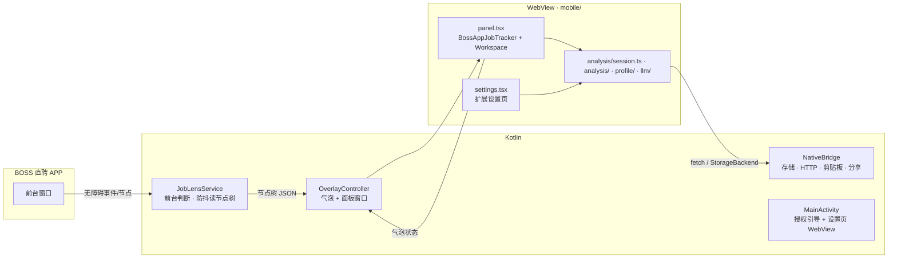

# JobLens Android 客户端：架构

在 BOSS 直聘原生 APP 中浏览职位时，JobLens 通过无障碍服务识别当前职位，在悬浮窗中给出匹配分析与打招呼语。用户一键复制后自行粘贴发送。分析能力与 Chrome 扩展共用同一套 TS 代码。

## 1. 边界（不可突破）

| 做 | 不做 |
|---|---|
| BOSS 在前台时读取当前窗口的无障碍文字 | 模拟点击或滑动（服务不声明 `canPerformGestures`，不执行任何节点 action） |
| 用户自己展开“查看更多”、滑动时补全 JD | 批量采集、遍历列表、自动投递、自动发消息 |
| 写入系统剪贴板，由用户自行粘贴 | 向 BOSS 输入框注入文字 |
| 只在用户点按悬浮按钮或面板按钮时调用模型 | 后台自动分析 |
| 读不到时如实提示 | 绕过安全窗口、破解字体反爬、隐藏自身无障碍服务；依赖系统长截图 |

## 2. 真机探针结论（BOSS 14.200 / Redmi · HyperOS 4.0 · Android 17）

| 项 | 结果 | 结论 |
|---|---|---|
| 详情页文字 | 头部（`tv_job_name` 等）和 JD 正文（单个 `tv_description` 节点）都可直接读取 | 走无障碍主路径 |
| 长 JD | 默认折叠，节点文字本身就以 `…  查看更多` 结尾；用户点开后同一节点就地展开为全文 | 截图/OCR 也只能看到折叠内容，不能补全；改为提示用户自己点“查看更多”，展开后自动补全 |
| 职位切换 | 列表点开新职位会产生 `BossJobPagerActivity` 窗口切换；详情页 ViewPager 把相邻职位放在屏幕左右两侧 | 用头部字段（标题/薪资/招聘者）判断身份；解析时跳过水平方向屏幕外的子树 |
| 标题噪声 | 标题末尾有角标占位符（如 ` &@`、` @%`） | 解析时去除 |
| 截图 | `takeScreenshotOfWindow` 成功，非安全窗口 | 暂不需要；保留 minSdk 30 以便以后做 OCR 兜底 |
| 读取耗时 | 单次节点导出 26–93 ms | 每次页面变化后防抖读取整窗即可 |
| 悬浮窗 / 剪贴板 | 正常；全程未闪退、未退出登录 | — |
| 前台判断 | 探针用 `isActive` 判断前台，点按悬浮窗后误判为离开 BOSS；正式版在详情面板点输入框时，输入法候选/剪贴板弹窗（同样报告为应用窗口且层级最高）又被误判为前台，面板被收起；无障碍悬浮窗层级高于锁屏，息屏后仍显示；从桌面启动 BOSS 时，判断时机落在启动动画期间而漏判 | `ForegroundResolver`：有输入焦点的应用窗口优先，否则层级最高的；排除输入法与 JobLens 自身的窗口；根节点读不到时保持现状。锁屏（`isKeyguardLocked`）或息屏时一律收起，亮屏/解锁后重新判断。尚未显示时，BOSS 的任何事件都会触发一次重新判断 |

OCR 兜底暂不实现：当前版本 BOSS 的文字全部可从节点读取，而 OCR 解决不了折叠问题。等出现“节点里没有文字”的页面再加。

## 3. 结构



| 层 | 文件 | 说明 |
|---|---|---|
| 无障碍服务 | `android/.../JobLensService.kt` | 只读；非 BOSS 事件只看包名。BOSS 内容变化后防抖 400 ms（最长 1.5 s）导出前台 BOSS 窗口节点树 |
| 节点解析 | `adapters/boss-app/parse.ts`、`tracker.ts` | 单帧解析 + 跨帧合并；输出与扩展相同的 `JobState`。`Job.descriptionTruncated` 标记折叠的 JD；指纹 `bossapp:` + 标题/公司/薪资/招聘者，在首次就绪时冻结 |
| 悬浮窗 | `android/.../overlay/` | `TYPE_ACCESSIBILITY_OVERLAY`，无需“显示悬浮窗”权限。`OverlayController` 管理气泡、速览卡（`QuickCard`）、底部提示（`BottomNotice`，不用 Toast：应用通知关闭时系统会屏蔽后台 Toast）与详情面板。面板 WebView 常驻：收起时脱离窗口但继续接收节点树、驱动气泡和速览卡；渲染进程被回收后自动重建 |
| 网页宿主 | `android/.../web/` | `WebViewAssetLoader` 加载 `assets/web`，只允许应用内页面；`NativeStorage`（local 为私有目录文件、session 仅内存）、`NativeHttp`（只允许 HTTPS 或本机 HTTP） |
| 平台差异 | `platform/index.ts`、`mobile/native.ts` | 打开设置、剪贴板、导出文件、域名授权、文案用语、能否弹原生下拉框；Android 由 `installNative` 注入 |
| 界面 | `entrypoints/sidepanel/App.tsx` 的 `Workspace` | 扩展侧边栏与 Android 悬浮面板共用；Android 额外传入 `analyzeRequest`（气泡点按）、`onStatusChange`（气泡状态）、`onClose` |

网页资源由 `pnpm run build:android-web`（`mobile/vite.config.ts`）生成，Gradle `preBuild` 自动调用，产物不入库。

## 4. 交互

- 气泡（`overlay/BubbleView.kt`）：浅色/深色底的圆片加一圈细环，像仪表盘。中间的品牌图形与应用图标一致（带对勾的放大镜）。灰色图形 = 未识别到职位；图形 + 主色满环 = 职位就绪，点按开始分析；琥珀满环 + `JD` = JD 被折叠；琥珀图形 = 需先完成设置；主色弧旋转 = 分析中（系统关闭动画时静止）；环按分数填充 + 中间分数 = 已出分（过期时琥珀）；红环 + `!` = 出错。按下时轻微缩小，拖动松手后吸附到最近的左右边缘。
- 点按气泡 = 一次快速分析：气泡旁弹出速览卡。
  - 已有结果：立即显示分数与结论，打招呼语写入剪贴板，底部提示“打招呼语已写入剪贴板”。
  - 可以分析（职位就绪、JD 已展开、设置完整，或已有结果但已过期）：调用模型，卡片显示“正在分析”，出分后同样自动写入剪贴板并提示。
  - 不能分析：不调用模型，卡片说明原因（如“JD 未展开：请先在 BOSS 点「查看更多」”）。
  - 本地检查未通过时仍会复制，但卡片提示“N 项本地检查未通过，发送前请看详情”。
- 速览卡：点“查看详情”展开详情面板；点“关闭”、再点气泡或点卡片以外任何位置收起。
- 详情面板：与扩展侧边栏同一界面，占屏幕下部 78%，可编辑、重写、存为样例、切换档案；返回键、右上角关闭或点气泡收起。JD 折叠时可在此手动“生成打招呼语”按已读内容分析。
- 同一职位 × 档案的阶段 A/B 结果由 `AnalysisSession` 缓存，切回已分析过的职位再点气泡只复制、不调用模型。
- 悬浮窗中的 WebView 弹不出原生下拉框，面板内的档案切换改用页内列表（`Platform.selectPopups`）。
- 微调要求是单次的：用于一次撰写后清空；这一版仍记住自己用过的要求，所以清空输入框不会让它显示为“写作设置已更新”。之后修改档案再分析，不会带上旧要求。
- 深浅色跟随系统：网页面板通过带 DayNight 主题的 Context 创建 WebView，使 `prefers-color-scheme` 生效；气泡、速览卡、底部提示按 DESIGN.md 的深色 token 绘制，系统切换时即时重绘。

### 权限与运行（设置页分区）

设置页导航中的“权限与运行”分区，仅在 Android 显示（`platform/index.ts` 的 `SetupHost`，界面 `entrypoints/options/SetupChecks.tsx`）。系统权限由原生检测（`android/.../setup/SetupChecks.kt`，经 NativeBridge 的 `setupChecks / setupAction / setupConfirm / consumeFirstRun` 调用）；“模型与简历档案”由设置页根据自身数据判断。首次启动时设置页直接打开该分区；每次从系统设置返回（`MainActivity.onResume`）重新检测，导航上的状态点显示是否全部完成。

| 项 | 检测方式 | 跳转 |
|---|---|---|
| 无障碍服务（必需） | `AccessibilityManager` 已启用列表 | 无障碍设置；应用信息（Android 13+ 侧载需“允许受限设置”） |
| 模型与简历档案（必需） | 设置页自身数据：模型连接就绪、当前档案存在 | 切到“模型连接”或“简历档案”分区 |
| 电池优化 | `PowerManager.isIgnoringBatteryOptimizations` | 系统确认框，失败时退回电池优化列表 |
| 省电策略：无限制（仅小米/HyperOS） | 无接口，用户勾选“我已设置” | `com.miui.powerkeeper` 的应用省电策略页，失败时退回应用信息 |
| 自启动（仅小米/HyperOS） | 无接口，用户勾选 | `com.miui.securitycenter` 的自启动管理，失败时退回应用信息 |
| 多任务界面加锁（仅小米/HyperOS） | 无接口，用户勾选 | 仅文字说明 |
| BOSS 直聘（必需） | 包是否安装 | — |

真机确认：小米/HyperOS 省电策略默认会冻结后台的 JobLens 进程，从桌面打开 BOSS 时无障碍事件收不到，悬浮按钮不出现；设为“无限制”后恢复。小米专属跳转按包名和类名直达，各系统版本路径可能不同，打不开时退回应用信息页。

## 5. 隐私与分发

- 档案、规则、样例存在应用私有目录；API Key 默认只在内存中，勾选“记住”才落盘（明文，界面已说明）。
- 节点树只在本机 WebView 内解析，不落盘；用户在“诊断 → 导出页面结构”中手动导出时才写入缓存并调起分享。
- 首次启动的权限检查页说明无障碍服务的读取范围、用途与不会执行的操作。
- 申请“忽略电池优化”（`REQUEST_IGNORE_BATTERY_OPTIMIZATIONS`）不符合 Google Play 对此权限的用途限制，与无障碍服务一样只适用于 GitHub Releases 分发。
- Google Play 限制非辅助功能用途的无障碍服务，计划通过 GitHub Releases 分发 APK。
- BOSS 能通过 `AccessibilityManager` 看到已启用的无障碍服务；JobLens 不隐藏自身。

## 6. 已验证 / 待验证

已在 Android 16 模拟器上验证（用系统“设置”冒充 BOSS 显示悬浮窗、通过 DevTools 注入真机节点样本、本机假模型服务）：设置页读写与跨 WebView 存储通知、模型连接测试走原生 HTTP；折叠 JD 时点气泡只显示原因不调用模型；完整 JD 点气泡后速览卡出分、打招呼语写入剪贴板并出现底部提示；已分析职位再次点按只复制不调用模型；速览卡的点外部收起、再点气泡收起与“查看详情”；详情面板中的键盘输入、档案列表切换、导出页面结构；离开前台时隐藏悬浮窗。

待真机验证：在 BOSS 中连续浏览时节点树推送的耗电与流畅度；HyperOS 省电策略下服务存活；左右滑动切换职位的识别；简历 PDF 上传（`pdf.worker` 已确认以 JS 类型下发）。

## 7. 开发

```bash
pnpm install
cd android && ./gradlew assembleDebug   # 需要 JDK 17+、Android SDK platform 37、PATH 中有 pnpm
```

APK：`android/app/build/outputs/apk/debug/app-debug.apk`。BOSS 改版导致识别失败时，在悬浮面板“诊断 → 导出页面结构”拿到节点树，更新 `adapters/boss-app/parse.ts` 并把样本加入 `tests/fixtures/boss-app/`。
